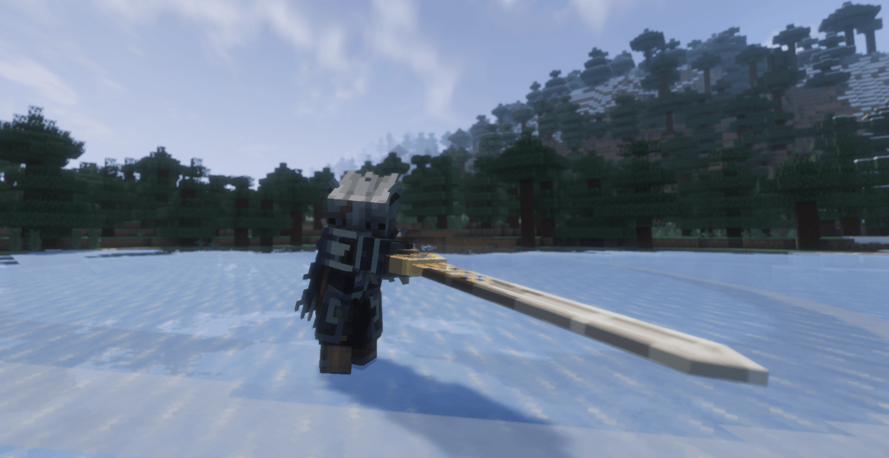
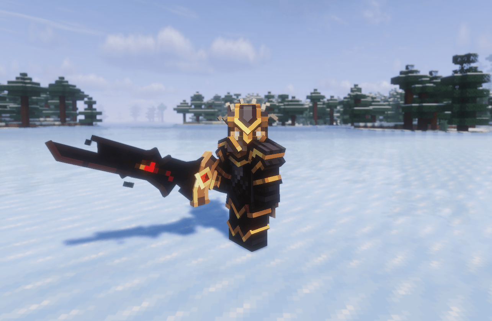
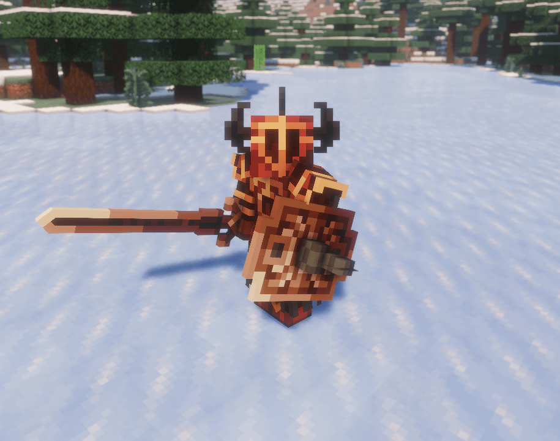
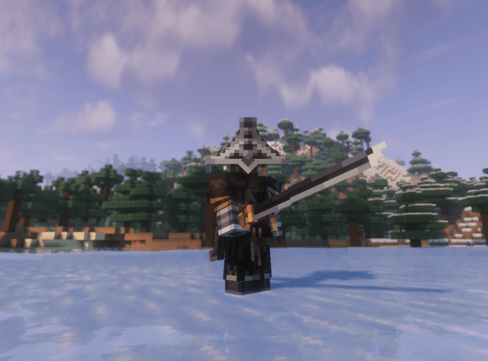
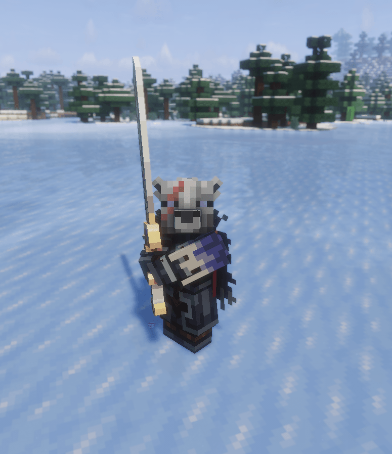

<p align="center">
  
</p>

<h1 align="center">SoulsCraft: Tarnished Legacy</h1>

<p align="center">
  <em>Relics of fallen champions, reforged for the Tarnished.</em><br>
  Animated armor, legendary weapons and greatshields inspired by Elden Ring, for Minecraft 1.20.1.
</p>

<p align="center">
  <a href="https://www.curseforge.com/minecraft/mc-mods/soulscraft-tarnished-legacy"></a>
  
  
</p>

<p align="center">
  
</p>

## Screenshots

| | |
|:---:|:---:|
| <br>Maliketh's armor and Black Blade | <br>Crucible Axe armor, Greatsword and Hornshield |
| <br>Ronin's armor | <br>Blaidd's armor |

## Features

### Armor sets

Eight fully modelled armor sets rendered with GeckoLib, several with capes that sway as you move. Wearing all four pieces of a set grants a full-set bonus.

| Set | Full-set bonus |
|---|---|
| **Night's Cavalry** | +20% movement speed. At night, also grants Night Vision. |
| **Blaidd** | +3 attack damage. |
| **Ronin** | Blocking an attack with a shield grants Strength for 4 seconds. |
| **Crucible Axe** | Resistance. |
| **Crucible Tree** | Fire Resistance. |
| **Tree Sentinel** | Absorption that renews every 10 seconds. |
| **Maliketh** | +6 attack damage. |
| **Radahn** | **Gravity Crash:** landing from a fall of 4+ blocks sends out a shockwave that damages and launches nearby enemies. |

All armor is enchantable and repairable with its set's material.

### Weapons

Every weapon has a unique trait.

| Weapon | Class | Trait |
|---|---|---|
| **Night's Cavalry Glaive** | Glaive | At night, hits have a chance to slow the target. |
| **Royal Greatsword** | Colossal Greatsword | Hits have a chance to heavily slow the target. |
| **Crucible Greatsword** | Greatsword | Hits have a chance to violently knock enemies away. |
| **Golden Halberd** | Halberd | At high health, hits can grant brief Absorption. |
| **Maliketh's Black Blade** | Colossal Sword | Hits have a chance to inflict Wither. |
| **Nagakiba** | Katana | **Blood Loss:** hits build up stacks; the 4th hit within 5 seconds bursts for 12% of the target's max health. |
| **Greatsword of Radahn (Lord)** | Colossal Sword | Right-click to chain up to three slashes, each answered by delayed pillars of light; the final cross-slash launches nearby foes. |

### Greatshields

| Shield | Trait |
|---|---|
| **Crucible Hornshield** | Blocking a melee attack throws the attacker back. |
| **Erdtree Greatshield** | Blocking an attack grants brief Absorption. |

### Relics and crafting

Gear is crafted from **relics** found around the world. Each relic has 4 uses and loses one with every craft.

| Relic | Where to find it | Crafts |
|---|---|---|
| Night Cavalry Insignia | Ruined portals, pillager outposts | Night's Cavalry set and Glaive |
| Shard of the Royal Oath | Woodland mansions, ancient cities | Blaidd set and Royal Greatsword |
| Primordial Crucible Scale | Stronghold corridors and crossings | Crucible Axe and Crucible Tree sets, Crucible Greatsword, Crucible Hornshield |
| Erdtree Sentinel Crest | Bastion treasure, desert pyramids | Tree Sentinel set, Golden Halberd, Erdtree Greatshield |
| Fragment of Destined Death | End cities, ancient city ice boxes | Maliketh set and Black Blade |
| Fallingstar Remnant | Abandoned mineshafts | Radahn set and Greatsword of Radahn |
| Soul in a Bottle | Dropped by Ghasts | Ronin set |

The Nagakiba is crafted from vanilla materials. Recipes unlock in the recipe book as you collect each relic, and every item appears in the **Tarnished Legacy** creative tab.

### Advancements

A dedicated **Tarnished Legacy** advancement tab tracks your progress:

| Advancement | How to earn it |
|---|---|
| **Tarnished Legacy** | Recover a relic of a fallen champion. |
| **Reforged** | Wear a complete armor set. |
| **Legacy of Champions** *(challenge)* | Wear every armor set. |
| **Starscourge Descends** | Slay a foe with Radahn's Gravity Crash. |
| **Hemorrhage** | Slay a foe with a Blood Loss burst. |
| **Let Them Bleed** *(hidden challenge)* | ??? |
| **Light of Miquella** | Slay a foe with the Greatsword of Radahn's pillars of light. |

Deaths from Blood Loss, Gravity Crash and the Starscourge's light have their own death messages.

## Installation

Download the mod from **[CurseForge](https://www.curseforge.com/minecraft/mc-mods/soulscraft-tarnished-legacy)** and install it, together with its dependencies, into a Minecraft **1.20.1** instance.

**Required**

- [Fabric Loader](https://fabricmc.net/) with [Fabric API](https://www.curseforge.com/minecraft/mc-mods/fabric-api), **or** [Forge](https://files.minecraftforge.net/)
- [Architectury API](https://www.curseforge.com/minecraft/mc-mods/architectury-api)
- [GeckoLib](https://www.curseforge.com/minecraft/mc-mods/geckolib)

**Optional**

- [Better Combat](https://www.curseforge.com/minecraft/mc-mods/better-combat-by-daedelus): adds attack animations and combos tailored to each weapon.

## Building from source

Requires JDK 17 or newer.

```sh
./gradlew build
```

The built jars are written to `fabric/build/libs/` and `forge/build/libs/`.

## Reporting issues

Found a bug? Please [open an issue](https://github.com/Bandit-bytes/soulscraft_tarnished_legacy/issues) with your Minecraft version, loader, mod version and, if possible, a crash report or log.

## License

Copyright © 2025-2026 Bandit-Bytes and Pixel Dream Studios. **All Rights Reserved.** See [LICENSE](LICENSE).

The source is public for reference only. Please don't re-upload or redistribute the mod; download it from [CurseForge](https://www.curseforge.com/minecraft/mc-mods/soulscraft-tarnished-legacy).

This is a fan-made project and is not affiliated with, endorsed by, or sponsored by FromSoftware, Inc. or Bandai Namco Entertainment Inc. Elden Ring and all related names are trademarks of their respective owners.
